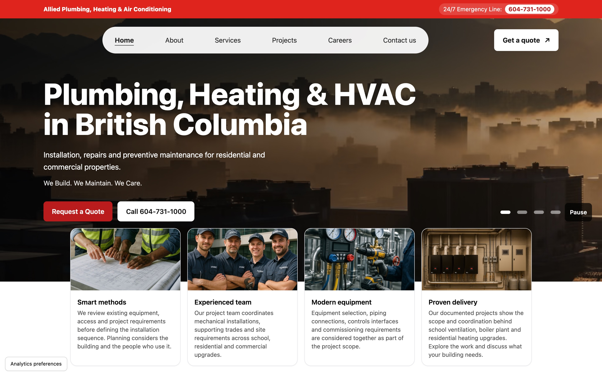
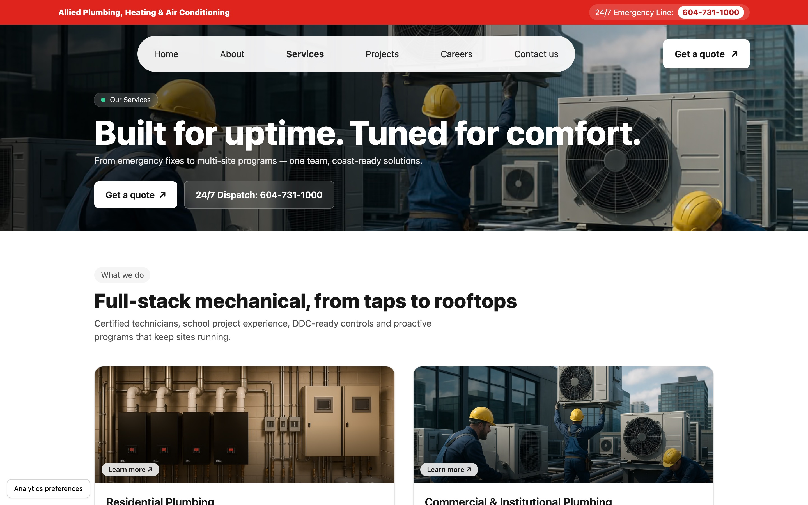
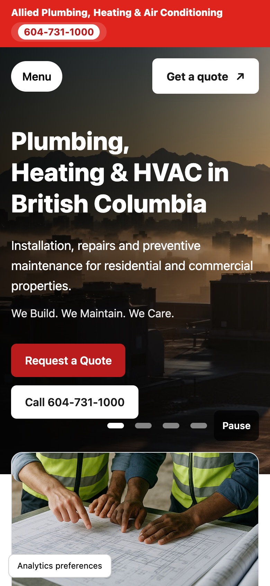
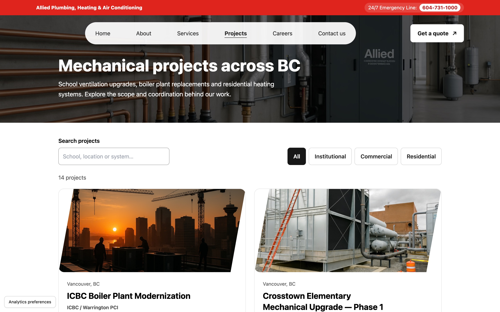

<div align="center">

# Allied Plumbing, Heating & Air Conditioning

**Production marketing and lead-generation platform for a British Columbia mechanical contractor.**

[](https://www.alliedplumbing.ca/)


**[www.alliedplumbing.ca →](https://www.alliedplumbing.ca/)**



</div>

---

## Overview

Allied Plumbing is a commercial and residential mechanical contractor (plumbing, heating, HVAC, boilers, preventive maintenance) serving British Columbia. This repository is the company's public website: the main channel for quote requests, emergency calls, project references and hiring.

The site is built like a product, not a brochure. Every route is prerendered for search engines, every form has a server-side backend with file validation and retention rules, analytics are consent-gated, and each release is checked against production by an automated script.

## Highlights

| | |
|---|---|
| **42 prerendered routes** | React SSR at build time produces static HTML with titles, canonicals and structured data for each page; sitemap is generated from the same route list. |
| **Lead capture pipeline** | Contact, Quote and Careers forms post to a Google Apps Script backend: dedupe by idempotency key, human-readable reference numbers, attachments stored in a private Drive with 90/180-day retention. |
| **Server-side file checks** | Quote accepts up to 4 PDF/JPG/PNG (10 MB total); Careers accepts one PDF up to 5 MB. Count, size, extension, MIME type and file signature are verified. |
| **Privacy-first analytics** | GA4 loads only after explicit opt-in. Lead and phone-call events are tracked; form contents and résumé links never are. |
| **Performance** | PageSpeed mobile: Performance 95, Best Practices 100, SEO 100, CLS 0, TBT 0 ms. Images served through Cloudinary with automatic format selection. |
| **Production verification** | `npm run test:production` checks every live route (HTTP status, title, canonical, prerendered h1), asset hashes against the local build, and the sitemap. |

## Screenshots

<table>
  <tr>
    <td width="70%"></td>
    <td width="30%" rowspan="2"></td>
  </tr>
  <tr>
    <td></td>
  </tr>
</table>

## What's on the site

- **Services**: residential plumbing, commercial and institutional plumbing, HVAC, boilers, preventive maintenance and 24/7 emergency response, each with its own landing page.
- **Projects**: case studies of school ventilation, boiler plant and residential heating work.
- **Get a quote / RFP**: structured request forms with drawing and photo uploads.
- **Careers**: open roles with a résumé upload flow.
- **Blog**: planning guides and editorial content for property managers and homeowners.

## Architecture

```
Browser ──► AWS Amplify (static, prerendered HTML + hashed assets)
   │
   ├─► Cloudinary         images (f_auto, responsive sizes)
   ├─► GA4                only after consent
   └─► Google Apps Script forms backend
          ├─ validation, dedupe, reference numbers
          ├─ MailApp notifications
          └─ private Drive storage with scheduled cleanup
```

## Tech stack

- **Frontend:** React 19, TypeScript, React Router 7, Tailwind CSS, Framer Motion
- **Build:** Vite with an SSR prerender pass and sitemap generation
- **Backend:** Google Apps Script (`apps-script/`)
- **Hosting:** AWS Amplify with managed redirects
- **Quality:** ESLint, Prettier, Node test runner (content, SEO, analytics, forms, Apps Script), production check script

## Getting started

```bash
npm install
npm run dev              # local dev server
npm run build            # type-check, build, prerender, sitemap
npm test                 # unit and content tests
npm run test:production  # verify the live site against this build
```

Requires Node 18.17 – 22.

## Project structure

```
src/
  pages/        route components (services, projects, careers, blog, quote)
  components/   shared UI, analytics consent, CTAs
  data/         projects, team, blog posts, SEO metadata (JSON)
  lib/          analytics consent and helpers
  scripts/      sitemap generation, production checks
  entry-server.tsx  SSR entry used for prerendering
apps-script/    Google Apps Script forms backend
tests/          automated tests
docs/           audits, performance reports, deployment notes
```

---

<div align="center">

Designed and built by [@Martikk](https://github.com/Martikk) · Live at **[alliedplumbing.ca](https://www.alliedplumbing.ca/)**

</div>
